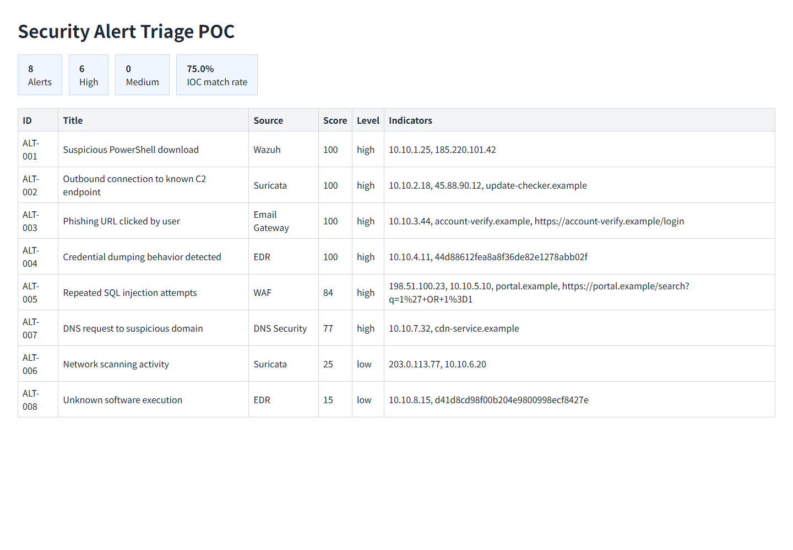

# Security Alert Triage and Threat Intelligence Enrichment POC

一个可本地运行的售前 POC：把原始告警转换为带威胁情报上下文、风险评分和处置建议的安全事件报告。

## 解决问题

企业 SOC 常见问题不是没有告警，而是：

- 告警数量太多，分析师难以按优先级处理；
- IOC 分散在不同平台，缺少统一富化和上下文；
- 风险等级依赖人工判断，处置标准不一致；
- 缺少可向客户展示的告警降噪和处置闭环。

本项目用可替换的数据源和本地脱敏样例，演示以下流程：

```text
样例告警 -> IOC 提取 -> 威胁情报富化 -> 风险评分 -> 处置建议 -> 报告输出
```

## 功能

- 支持 JSONL 告警输入；
- 提取 IP、域名、URL 和文件哈希；
- 使用本地威胁情报库进行 IOC 匹配；
- 按告警等级、资产重要性和情报命中计算风险分；
- 输出高危、中危、低危和三档处置建议；
- 生成 JSON、Markdown 和 HTML 报告；
- 将情报标签映射到 MITRE ATT&CK 技术编号；
- 提供零依赖 Web 看板和 Docker Compose 演示环境。



## Quick Start

```bash
PYTHONPATH=src python -m alert_triage.cli
```

启动看板：

```bash
PYTHONPATH=src python -m alert_triage.web --port 8080
```

浏览器打开 <http://localhost:8080>。

## Docker

```bash
docker compose up --build
```

打开 <http://localhost:8080>。

## 项目结构

```text
data/               脱敏样例告警和本地威胁情报
src/alert_triage/   告警处理、富化、评分、报告和 Web 看板
tests/              核心流程单元测试
docs/               售前方案、Demo、部署、FAQ 和成本收益
  security-discovery-and-pain-points.md
  bid-and-implementation-package.md
  network-and-device-basics.md
  product-comparison-framework.md
```

## 样例输出

`outputs/latest.md` 和 `outputs/latest.html` 会输出：

- 告警总数和高、中、低风险数量；
- IOC 命中率；
- 每条告警的风险分和处置建议；
- 可直接用于客户演示的分析结论。

## Benchmark

The project includes a controlled synthetic benchmark with 240 labeled alerts.

Run:

```bash
PYTHONPATH=src python scripts/generate_benchmark.py
PYTHONPATH=src python scripts/run_benchmark.py
```

The benchmark compares severity-only routing with IOC-enriched risk scoring and reports false-positive reduction and an explicitly labeled MTTI estimate.

## 边界

- 当前使用本地脱敏样例数据和本地威胁情报，不包含真实客户数据；
- 本项目用于展示告警分诊、威胁情报富化、POC 交付和方案表达能力；
- 不执行主动攻击、漏洞利用或真实环境处置；
- 后续可扩展 OTX、AbuseIPDB、GreyNoise、Wazuh、Suricata 等数据源。

## License

MIT License. See [LICENSE](LICENSE).


