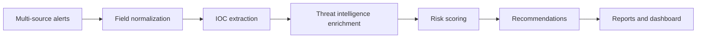

# 安全告警分诊与威胁情报增强方案

## 客户问题

安全运营团队面临告警数量大、上下文分散、误报多和处置标准不统一的问题。单个分析师需要同时查看 SIEM、EDR、NDR、邮件网关和威胁情报平台，导致调查时间被重复操作占用。

## 方案目标

1. 把多源告警统一为结构化事件；
2. 自动抽取 IP、域名、URL 和文件哈希；
3. 对 IOC 进行威胁情报富化；
4. 结合资产重要性和情报命中计算风险分；
5. 生成处置建议和事件报告；
6. 为后续接入 SIEM、SOAR、EDR 和 MCP 工具链预留接口。

## 处理流程

```text
多源告警
  -> 字段标准化
  -> IOC 提取
  -> 威胁情报查询
  -> 风险评分
  -> 处置建议
  -> 报告与看板
```



## 评分模型

风险分由以下因素组成：

- 原始告警等级；
- 资产重要性；
- IOC 情报判定；
- 情报置信度；
- 情报标签，例如 C2、钓鱼、勒索、凭据访问和扫描。

结果分为：

| 风险等级 | 分数 | 处置 |
|---|---:|---|
| 高危 | 70-100 | 立即隔离、保留证据、启动响应 |
| 中危 | 40-69 | 二次验证、关联资产排查、人工确认 |
| 低危 | 0-39 | 观察、补充上下文、暂不升级 |

## POC 验收标准

- 输入 8 条样例告警，完整输出 JSON、Markdown 和 HTML 报告；
- 高危告警可以解释评分来源和命中 IOC；
- Dashboard 能看到风险分级和 IOC 命中率；
- Docker Compose 一条命令启动；
- 输出可复用的部署 SOP、Demo 脚本和成本收益说明。

## 后续扩展

- 接入 Wazuh 或 Suricata 的真实采集层；
- 接入 OTX、AbuseIPDB、GreyNoise；
- 接入企业资产库和 CMDB；
- 增加 MITRE ATT&CK 映射；
- 通过 MCP 暴露告警查询和情报查询工具；
- 将确定性处置建议升级为大模型辅助总结。


